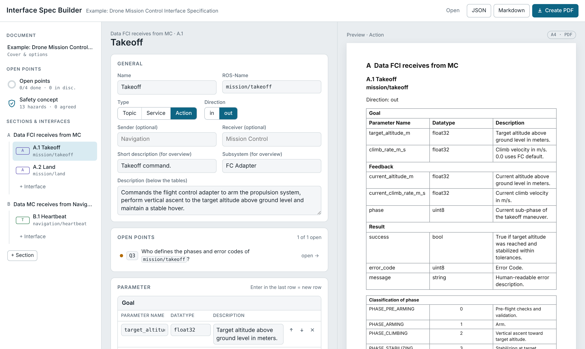

# ROS 2 Interface Spec Builder

A lightweight, browser-based tool for creating and documenting ROS 2 interface specifications, tracking design decisions, and exploring safety concepts.

**[Try it online](https://jlorenz-eng.github.io/ros2-interface-spec-builder/)**



## Features

- **Interface specifications:** Define ROS 2 topics, services, and actions, including fields, data types, and enums.
- **Review board:** Track open questions, design decisions, and responsibilities.
- **Safety concepts:** Define hazards, safety levels, and escalation rules with an interactive simulator.
- **Live preview:** See the generated documentation while editing.
- **Export:** Generate PDF and Markdown documents or save entire projects as JSON.
- **Import:** Load existing projects or merge selected parts of multiple projects.
- **Local storage:** No backend or installation required.

## Usage

Open the [web app](https://jlorenz-eng.github.io/ros2-interface-spec-builder/) or download `index.html` and open it in your browser.

Changes are automatically saved in your browser. Export your project as JSON to back it up or continue working on another device.

## Importing open points from Markdown

The review board can import questions and review results from Markdown. Open **Open points**, click **Import**, and paste the text or load a `.md` file.

Each heading becomes a section, and each table row becomes a point:

```markdown
## Decisions that affect all teams

| ID | Question | Context | Answer from | Raised by | Decision |
|---|---|---|---|---|---|
| Q1 | Which coordinate frame is used? | Navigation uses ENU, the flight controller NED. | Navigation, FC | Review | |
| Q2 | Common heartbeat rate and timeout | Only one module defines a timeout. | all teams | Review | 1 Hz, 3 s timeout |
```

- **Recognised columns:** `ID`, `Question` (or `Item`, `Fix`), `Context`, `Answer from` (or `Owner`), `Raised by`, `Decision`. Column order does not matter.
- **Teams:** Separate several teams in `Answer from` with commas. The value `all teams` counts for every team.
- **Decisions:** A filled `Decision` cell marks the point as decided.
- **Document comparisons:** Two additional columns become a side-by-side comparison, for example `| Item | Our document | Team B document |`.
- **Links to interfaces:** Names in `backticks` (topics, fields, enum values) are linked to the matching interfaces.
- **IDs:** Rows without an ID get one automatically. Rows whose ID already exists are skipped, so you can import an updated list again.

## Notes

This is an experimental tool created with AI assistance for personal use in ROS 2 development. It is provided as-is and may contain bugs.

The safety simulator is intended for conceptual exploration and does not replace formal safety analysis or validation.

## License

MIT
